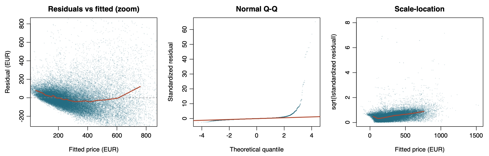
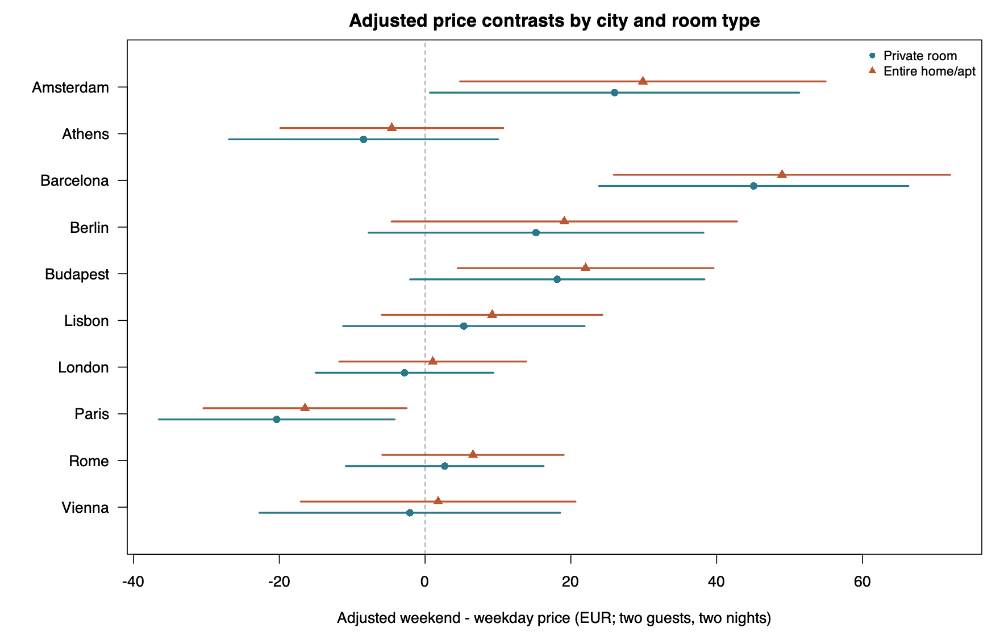
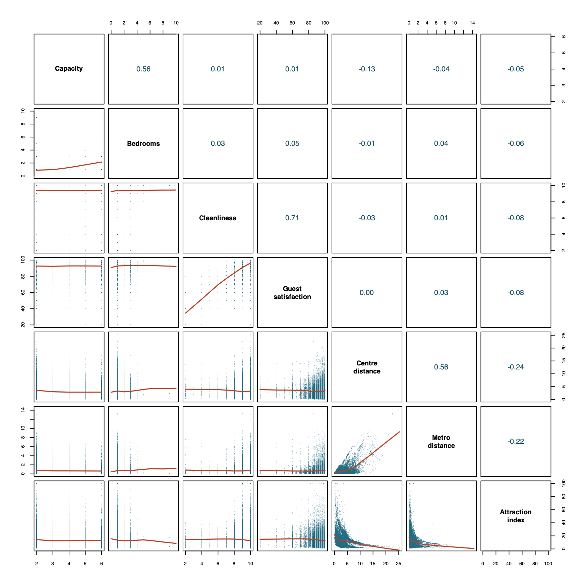
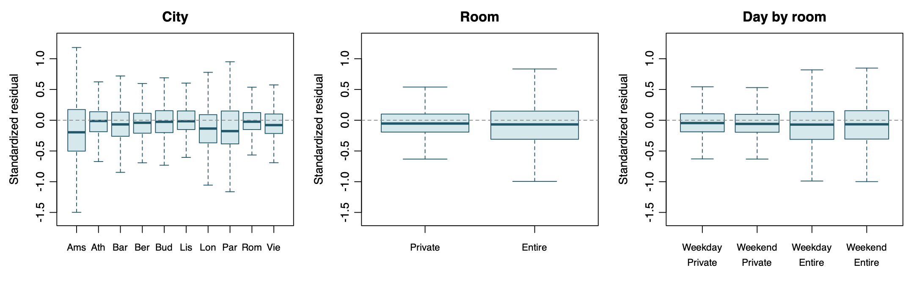

# Preliminary results

## Model fit

OLS used 12 predictors and three two-way interactions (n=51,341). In-sample R²=0.2614, adjusted R²=0.2608, RSE=€282.73, and overall F=453.89 (p<0.001).

The common interaction across cities was estimated at +€3.88 for the entire-minus-private difference in adjusted weekend–weekday contrasts. Its classical 95% CI [−€7.33, €15.09] spans zero (partial F=0.46, p=0.497).

Table 2. Estimates (classical SEs) in EUR per two-person, two-night offer. References are Amsterdam, weekdays, private rooms, non-Superhosts and single offers. City interactions are deviations from Amsterdam’s contrasts.

| Term / city | Estimate (SE) | City × weekend (SE) | City × entire (SE) |
| --- | ---: | ---: | ---: |
| Intercept | −12.34 (18.89) | | |
| `day_type`: weekends | 26.00 (12.92) | | |
| `room_type`: entire home/apt | 285.87 (12.93) | | |
| `person_capacity` | 27.80 (1.40) | | |
| `bedrooms` | 81.00 (2.51) | | |
| `cleanliness_rating` | 5.76 (1.90) | | |
| `guest_satisfaction_overall` | 0.93 (0.21) | | |
| `host_is_superhost`: Superhost | 4.96 (3.06) | | |
| `dist` | −0.36 (0.94) | | |
| `metro_dist` | −4.95 (1.88) | | |
| `attr_index_norm` | 6.58 (0.20) | | |
| `host_portfolio`: 2–4 offers | 8.47 (3.23) | | |
| `host_portfolio`: 5+ offers | 25.09 (3.28) | | |
| Weekend × Entire home/apt (δ) | 3.88 (5.72) | | |
| Athens | −216.28 (18.34) | −34.45 (14.91) | −302.27 (19.46) |
| Barcelona | −192.49 (13.23) | 19.09 (16.67) | 0.29 (18.67) |
| Berlin | −207.25 (14.25) | −10.78 (17.06) | −170.74 (17.43) |
| Budapest | −250.31 (17.98) | −7.86 (15.52) | −279.88 (19.35) |
| Lisbon | −180.26 (13.32) | −20.68 (14.62) | −238.46 (15.05) |
| London | −175.93 (12.03) | −28.83 (13.78) | −50.85 (13.92) |
| Paris | −88.02 (13.44) | −46.35 (14.40) | −182.06 (15.13) |
| Rome | −198.85 (12.07) | −23.31 (13.88) | −280.35 (14.10) |
| Vienna | −142.72 (15.53) | −28.09 (15.80) | −277.50 (17.15) |

Positive bedroom and attraction slopes agree directionally with Gyódi and Nawaro (2021a). The centre-distance CI includes zero.

## Regression diagnostics

- **Linearity.** The U-shaped residual–fitted curve suggests mean misspecification.
- **Constant variance.** Scale–location rises after an initial dip. Residual IQR is larger for entire homes.
- **Normality.** The residual Q–Q plot departs sharply in the upper tail.
- **Independence.** Spatial patches and possible repeated listings or hosts leave independence unresolved.

Design rank was 41/41. Numeric VIFs were 1.61–3.27, δ’s was 4.61, and some indicator VIFs exceeded 5. Classical inference remains provisional.

Figure 1. Residual diagnostics. Left axes show central 99% ranges.

[Supplementary diagnostics](Preliminary_Results_Diagnostics.md)

---

## Supplementary figures

### Adjusted weekend–weekday contrasts

The fitted contrasts are positive in Barcelona (+€45.09 for private rooms and +€48.97 for entire homes) and negative in Paris (−€20.35 and −€16.47, respectively). The model allows these contrasts to vary by city and estimates a common entire-minus-private gap of €3.88.

Figure 2. Adjusted price contrasts for two guests and two nights. Horizontal bars show pointwise classical 95% CIs for the individual contrasts.

### Predictor pairs

Cleanliness and guest satisfaction have the strongest Pearson correlation among the seven numerical predictors (r = 0.713). Attraction accessibility falls most steeply near the city centre. The curve shows structure beyond the modest Pearson correlation with centre distance (r = −0.242).

Figure 3. The lower panels show scatterplots with LOWESS smoothers. The upper panels show Pearson correlations.

### Group residual boxplots

Entire homes have a wider standardized residual IQR than private rooms (0.457 versus 0.293). Weekday and weekend IQRs are similar within each room type. The difference by room type reinforces the concern about constant variance.

Figure 4. Standardized residual boxplots on a common vertical scale. Individual outlier markers are omitted.
