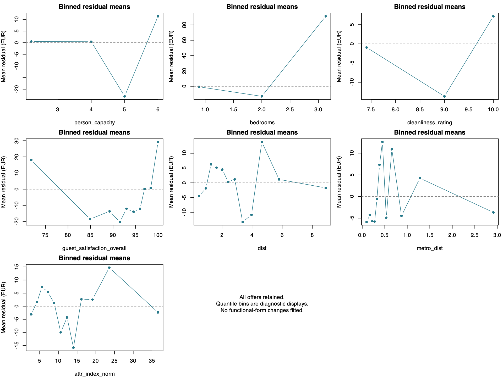
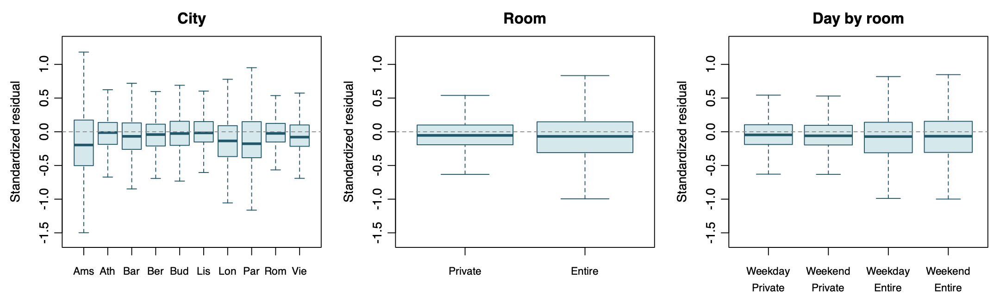
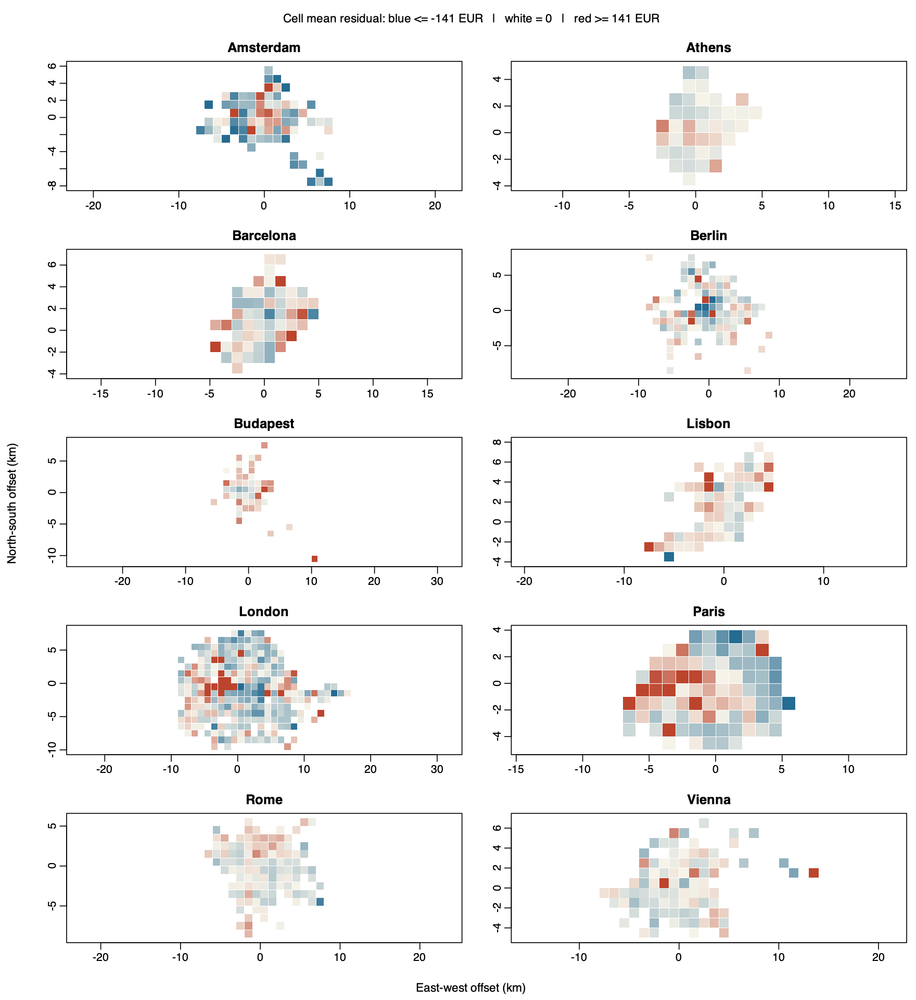
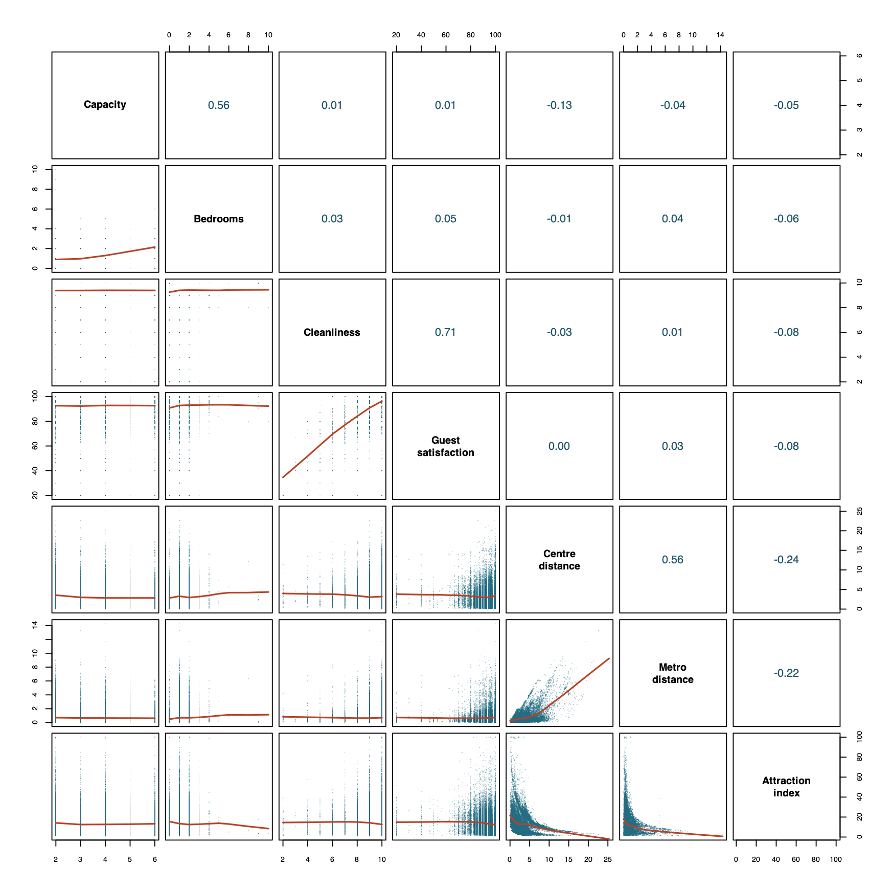

# Supplementary diagnostics for the preliminary OLS model

The plots use the preliminary OLS fit for the 51,341 sampled offers. The response is the advertised total in EUR for two guests and two nights. The [preliminary results](Preliminary_Results.md) contain the core residual plots and coefficient table.

## Model fit and inference

The model explains 26.14% of the observed price variation in the fitted sample. Adjusted R² is 0.2608 and the residual standard error is €282.73. The classical overall F(40, 51,300) is 453.89 (p < 0.001). The partial F(1, 51,300) is 0.46 (p = 0.497) when the reduced model drops only Weekend × Entire home/apt and uses the same response and offers. Residual curvature, unequal spread and possible dependence make the classical tests and intervals provisional.

## Conditional mean

Mean residuals are +€57.57 in the lowest fitted decile, reach −€37.76 in the seventh and return to +€43.29 in the highest. Binned residuals for guest satisfaction show a similar bend, with positive means at the ends and negative means over much of the middle range. These patterns suggest that the fitted conditional mean misses systematic structure.

Figure S1. Mean raw residuals versus the mean predictor value in each bin. The dashed line marks zero.

## Constant variance and normality

Raw residual IQR rises from €73.70 in the lowest fitted decile to €293.65 in the highest. The group plots also show wider standardized residual IQRs for entire homes (0.457) than for private rooms (0.293), and in Amsterdam (0.676) compared with Rome (0.276). Within each room type, the weekday and weekend IQRs are similar. The Normal Q–Q plot in the main report shows a pronounced right-tail departure, so the normal-error approximation is poor.

Figure S2. Standardized residual boxplots on a common vertical scale. Individual outlier markers are omitted.

## Independence

The residual map shows patches of adjacent cells with the same sign, including in Paris. Such patterns could reflect omitted spatial mean structure or dependence between nearby offers. Weekday and weekend samples are unmatched, and the files contain no stable listing or host identifiers. Independence remains unresolved.

Figure S3. Mean raw residuals in approximate 1 km cells containing at least five offers. The color scale saturates at ±€141.

## Predictor relationships and multicollinearity

The pairs plot shows that mean attraction accessibility falls most steeply near the city centre. This curved predictor relationship calls for care when interpreting marginal plots. The strongest numeric Pearson correlation is between cleanliness and guest satisfaction (r = 0.713).

Figure S4. Numerical predictor pairs. The lower panels show scatterplots and LOWESS smoothers. The upper panels show Pearson correlations.

The design matrix has rank 41 for 41 columns. Ordinary VIFs use the other columns of the full model matrix, including the interaction columns, in each auxiliary regression. These are column-level VIFs under the model’s reference coding. The course’s VIF > 5 screen flags 25 of 40 columns, mostly city indicators and their interactions. The focal interaction and all seven numeric predictors fall below that screen. Large VIFs for reference-coded main effects indicate reduced precision for those coefficients under this parameterization.

| Model-matrix column | VIF |
| --- | ---: |
| Person capacity | 2.11 |
| Bedrooms | 1.61 |
| Cleanliness rating | 2.10 |
| Guest satisfaction | 2.18 |
| Centre distance | 3.27 |
| Metro distance | 1.67 |
| Attraction index | 2.45 |
| Weekend × Entire home/apt (δ) | 4.61 |
| Weekend indicator | 26.82 |
| Entire-home indicator | 24.84 |
