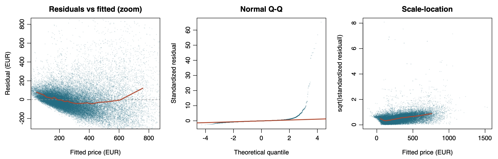
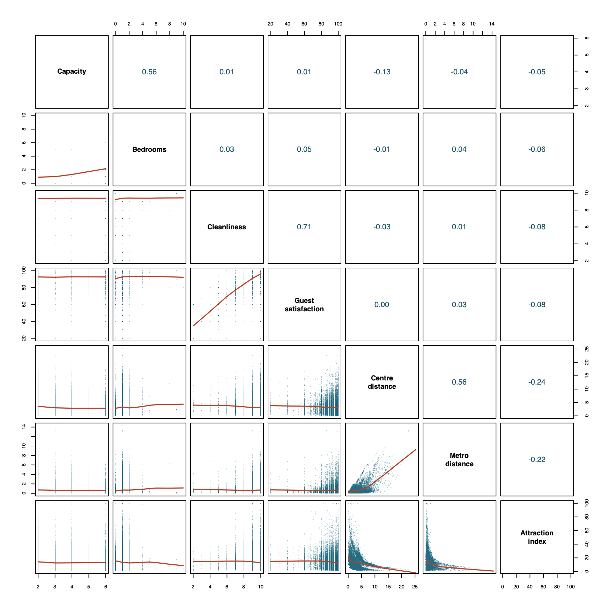
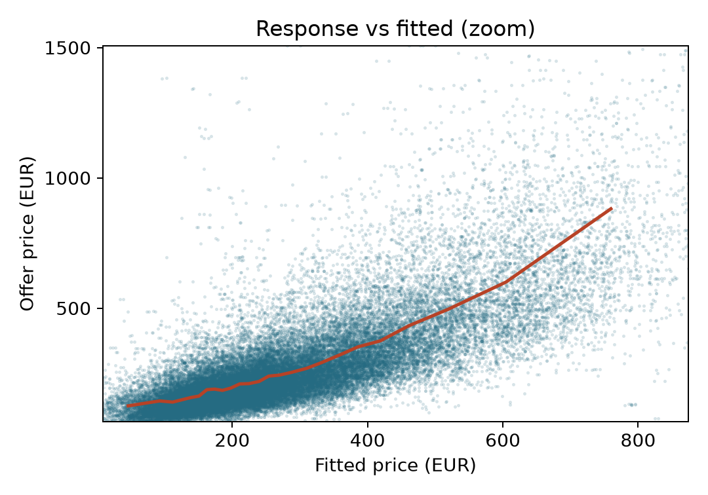

# Preliminary results

OLS fitted 12 predictors (n=51,341). Evidence that adjusted weekend–weekday contrasts differ by room type is insufficient (95% CI −7.33 to 15.09; p=0.497).

Table 2. All coefficients (SEs), EUR. References: Amsterdam, weekdays, private rooms, non-Superhosts, single offers.

| Term / city | Estimate (SE) | City × weekend (SE) | City × entire (SE) |
| --- | ---: | ---: | ---: |
| Intercept | −12.34 (18.89) | | |
| `day_type`: weekends | 26.00 (12.92) | | |
| `room_type`: entire home/apt | 285.87 (12.93) | | |
| `person_capacity` | 27.80 (1.40) | | |
| `bedrooms` | 81.00 (2.51) | | |
| `cleanliness_rating` | 5.76 (1.90) | | |
| `guest_satisfaction_overall` | 0.93 (0.21) | | |
| `host_is_superhost`: Superhost | 4.96 (3.06) | | |
| `dist` | −0.36 (0.94) | | |
| `metro_dist` | −4.95 (1.88) | | |
| `attr_index_norm` | 6.58 (0.20) | | |
| `host_portfolio`: 2–4 offers | 8.47 (3.23) | | |
| `host_portfolio`: 5+ offers | 25.09 (3.28) | | |
| `day_type × room_type` | 3.88 (5.72) | | |
| Athens | −216.28 (18.34) | −34.45 (14.91) | −302.27 (19.46) |
| Barcelona | −192.49 (13.23) | 19.09 (16.67) | 0.29 (18.67) |
| Berlin | −207.25 (14.25) | −10.78 (17.06) | −170.74 (17.43) |
| Budapest | −250.31 (17.98) | −7.86 (15.52) | −279.88 (19.35) |
| Lisbon | −180.26 (13.32) | −20.68 (14.62) | −238.46 (15.05) |
| London | −175.93 (12.03) | −28.83 (13.78) | −50.85 (13.92) |
| Paris | −88.02 (13.44) | −46.35 (14.40) | −182.06 (15.13) |
| Rome | −198.85 (12.07) | −23.31 (13.88) | −280.35 (14.10) |
| Vienna | −142.72 (15.53) | −28.09 (15.80) | −277.50 (17.15) |

Bedroom and attraction slopes agree directionally with Gyódi and Nawaro (2021a).

- **Linearity:** Residual curvature suggests mean misspecification.
- **Variance:** Rising scale-location suggests unequal variance.
- **Error normality:** Q-Q upper tails depart from the reference line.
- **Independence:** Unverified; nearby or repeated listings/hosts may be dependent.
- **Conditional mean response:** Figure 3 shows an increasing response trend; dependence on one linear combination remains unverified.
- **Conditional mean predictors:** Curved attraction–distance trends (Figure 2) suggest nonlinearity, limiting residual interpretation.
- **Multicollinearity:** Full rank excludes exact collinearity; some indicator VIFs >5 warrant caution.

Inference remains provisional; no repairs applied.

Figure 1. Residual diagnostics; left axes zoom central 99%.

Figure 2. Predictor pairs: smoothers below, Pearson correlations above.

Figure 3. Response versus fitted: central 99% ranges; line joins bin means.
